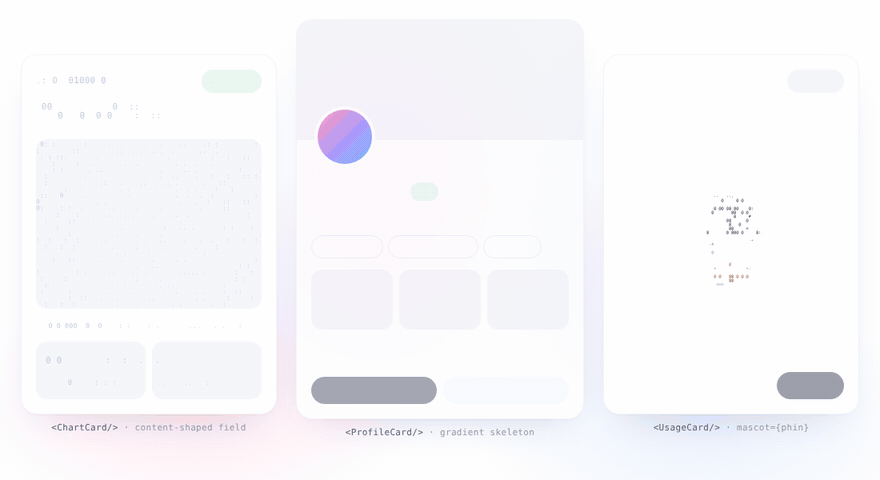

<p align="center">
  <a href="https://tomdesign.vn"></a>
</p>

<h1 align="center">TomLoad</h1>

<p align="center"><b>Loading states, decoded.</b><br>
Glyph skeletons, ASCII mascots and a decode-in reveal for any DOM element.<br>
Zero dependencies · ~7 KB gzipped · MIT</p>

<p align="center">
  <a href="https://johnny-bui.github.io/TomLoad/"><b>Live demo & docs →</b></a>
</p>

<p align="center">
  <a href="https://johnny-bui.github.io/TomLoad/"></a>
</p>

```js
import { glyph, skeleton, mascots } from 'tomload';

card.innerHTML = skeleton({ variant: 'braille', lines: 4 });   // 1. paints instantly — pure HTML + CSS

const data = await fetchProduct();                              // 2. data arrives
card.innerHTML = renderProduct(data);
const g = glyph(card);
g.hide({ instant: true });
g.loading(true, { mascot: mascots.phin });                      //    optional: a mascot while images settle

g.loading(false);                                               // 3. decode in
await g.reveal({ origin: 'top' });
```

---

## Why TomLoad

- **No layout shift.** Real content stays in the DOM, in its real position. The effect is drawn on one canvas above it.
- **Works on any element.** Text, ``, `<canvas>` and `<video>` decode through the glyph grid; buttons and icons fade in on the wave.
- **Loading that looks like the content.** Without a mascot, `loading(true)` draws glyphs only where text lines, images and buttons are about to land — no gray boxes, no stripes.
- **Brandable.** Four glyph voices, six ready-made mascots (Vietnam + Holiday sets), or draw your own.
- **Accessible.** Screen readers read the real text the whole time, `aria-busy` is set while loading, and `prefers-reduced-motion` turns every reveal into a short fade.
- **Framework-free.** Plain DOM API — works in React, Vue, Nuxt, Svelte, WordPress or a static page.

## Install

```bash
npm i github:johnny-bui/TomLoad#v0.1.0
```

No build step? Drop the browser build into any page — it exposes a global `TomLoad`:

```html
<script src="https://cdn.jsdelivr.net/gh/johnny-bui/TomLoad@v0.1.0/dist/tomload.iife.js"></script>
<script>
  const { glyph, skeleton, mascots } = TomLoad;
</script>
```

TypeScript types ship in `dist/tomload.d.ts`.

## Usage

### Decode content in

```js
const g = glyph(document.querySelector('.card'));
g.hide({ instant: true });
await g.reveal();                       // origin 'top' · 'center' · 'pointer' · { x, y }
```

### A real loading cycle

```js
const g = glyph(card, { preset: 'spark' });

await g.hide();                         // scramble the old content out
g.loading(true);                        // content-shaped glyph field (or pass { mascot })
render(card, await fetchData());
g.loading(false);
await g.reveal();
```

### Skeleton only (no JavaScript loop)

```js
el.innerHTML = skeleton({ variant: 'dots', lines: 4 });     // dots · blocks · binary · braille · plus
el.innerHTML = skeleton({ variant: 'blocks', rows: 8 });    // image / avatar block
```

The same `seed` always produces the same markup, so it is safe to render on the server.

### React

```jsx
import { useLayoutEffect, useRef } from 'react';
import { glyph, mascots } from 'tomload';

export function ProductCard({ data }) {
  const ref = useRef(null);
  useLayoutEffect(() => {                    // runs before paint → no flash
    if (!data) return;
    const g = glyph(ref.current);
    g.hide({ instant: true });
    g.reveal({ origin: 'top' }).then(() => g.destroy());
    return () => g.destroy();
  }, [data]);
  return <article ref={ref}>{data ? <Product {...data} /> : null}</article>;
}
```

### Vue / Nuxt

```vue
<script setup>
import { ref, watch, nextTick } from 'vue';
import { glyph } from 'tomload';

const props = defineProps({ data: Object });
const el = ref(null);
watch(() => props.data, async (d) => {
  if (!d) return;
  await nextTick();
  const g = glyph(el.value);
  g.hide({ instant: true });
  await g.reveal();
  g.destroy();
});
</script>

<template><article ref="el"><Product v-if="data" v-bind="data" /></article></template>
```

> In Nuxt, run TomLoad on the client only (`onMounted`, `<ClientOnly>` or a `.client` plugin). `skeleton()` is safe on the server.

## API

### `glyph(element, options?) → controller`

| Option | Default | Notes |
|---|---|---|
| `preset` | `'ink'` | `'ink'` · `'dither'` · `'spark'` · `'binary'`, or a custom preset object |
| `speed` | `1` | Wave speed multiplier (≈ 1.1 px/ms). `0.5` for hero moments |
| `origin` | `'top'` | `'top'` · `'center'` · `'pointer'` · `{ x, y }` in viewport px |
| `accent` | `--tl-accent` | Scramble glyph color for presets with `accent: true` |
| `media` | `img, canvas, video, [data-tl="media"]` | Elements decoded through the glyph grid |
| `fades` | `button, svg, [data-tl="fade"]` | Elements that fade in when the wave reaches them |

| Method | |
|---|---|
| `reveal({ origin, speed })` | Decode content in. Resolves when everything has landed |
| `hide({ instant, origin, speed })` | Scramble content out (or hide instantly). It stays hidden until `reveal()` |
| `loading(on, { mascot, size, cell, offsetY })` | Content-shaped glyph field, or a mascot (default box 132 px) while data loads |
| `update(options)` | Merge new options, e.g. switch preset |
| `destroy()` | Stop everything and restore the element |
| `state` | `'shown'` · `'hidden'` · `'revealing'` · `'hiding'` |

### `skeleton({ lines, variant, widths, rows, seed, chars }) → string`

Static glyph rows with a pure-CSS shimmer sweep. Variants: `dots`, `blocks`, `binary`, `braille`, `plus`, or any string of characters.

### Presets

| Preset | Look | Best for |
|---|---|---|
| `ink` | Condenses `.:-=+*#@`, then letters & digits | Product UI, dashboards |
| `dither` | Shaded blocks `░▒▓█`, images keep their colors | Image-heavy cards |
| `spark` | `* + ✦ ✧`, accent colored | Festive, playful brands |
| `binary` | `0` and `1`, accent colored | Dev tools, fintech |

```js
glyph(el, { preset: { ramp: ' .:oO@', glyphs: 'OoO0', cell: 9, tick: 60, char: [240, 520], accent: true } });
```

### Mascots

`mascots.phin` (coffee filter), `mascots.hat` (conical hat), `mascots.lantern` — Vietnam set
`mascots.snowman`, `mascots.tree`, `mascots.gift` — Holiday set

A mascot is any draw function `(ctx, width, height, seconds) => void`:

```js
const pulse = (ctx, w, h, t) => {
  ctx.fillStyle = '#7b6cff';
  ctx.beginPath();
  ctx.arc(w / 2, h / 2, Math.min(w, h) * (0.25 + 0.05 * Math.sin(t * 4)), 0, Math.PI * 2);
  ctx.fill();
};
g.loading(true, { mascot: pulse, size: 96 });
```

### CSS hooks

| Variable | Used for |
|---|---|
| `--tl-accent` | Scramble glyph color |
| `--tl-skeleton` | Skeleton and glyph-field color |
| `--tl-size` | Skeleton glyph size |
| `--tl-sweep` | Skeleton sweep duration |

## Notes

- Images must be same-origin or CORS-enabled to be sampled into glyphs; otherwise they simply fade in.
- One canvas per running element, one shared animation loop for every instance.
- Works in current Chrome, Edge, Safari and Firefox.

## Develop

```bash
npm install
npm run build     # builds dist/ and copies the browser build into docs/
npm run dev       # serves docs/ locally
```

```
src/        tomload.js (engine) · mascots.js · index.js
dist/       tomload.js (ESM) · tomload.iife.js (global TomLoad) · tomload.d.ts
docs/       GitHub Pages site
examples/   basic.html
```

## License

MIT © 2026 [Tomdesign](https://tomdesign.vn) — Johnny Bui
